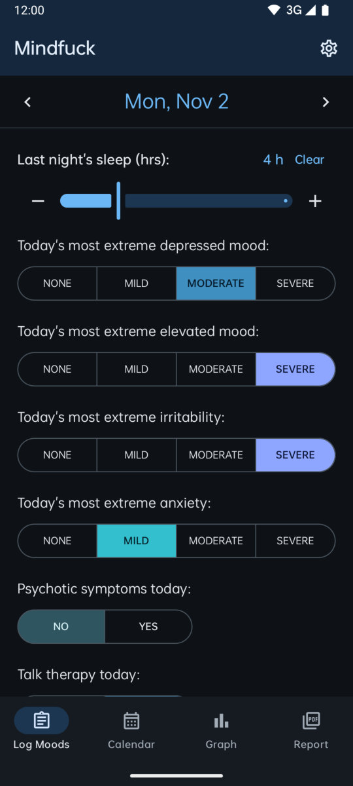
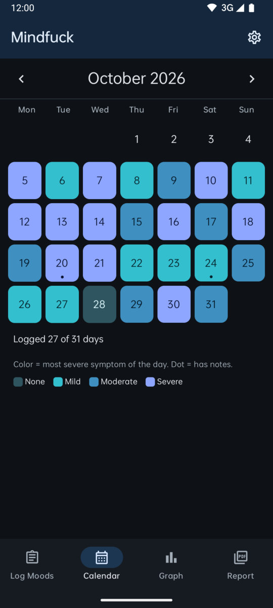
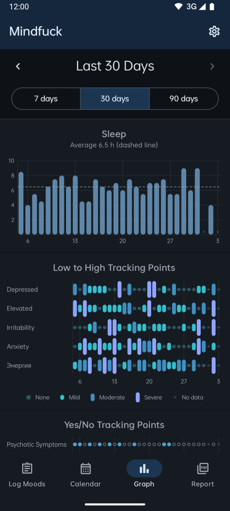
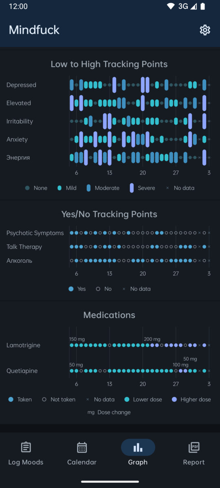
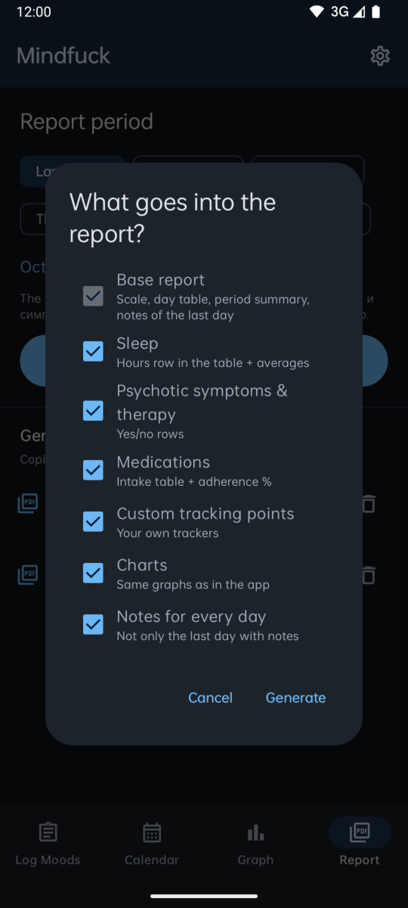
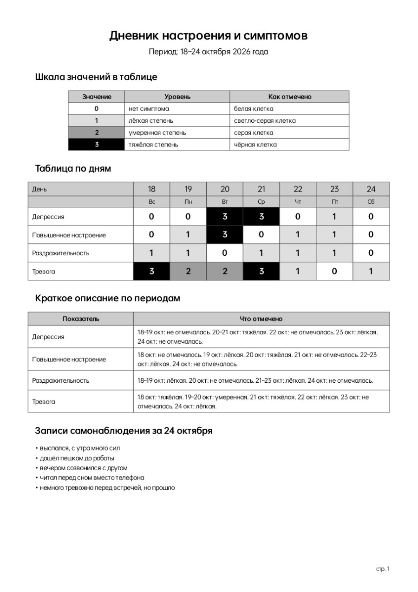
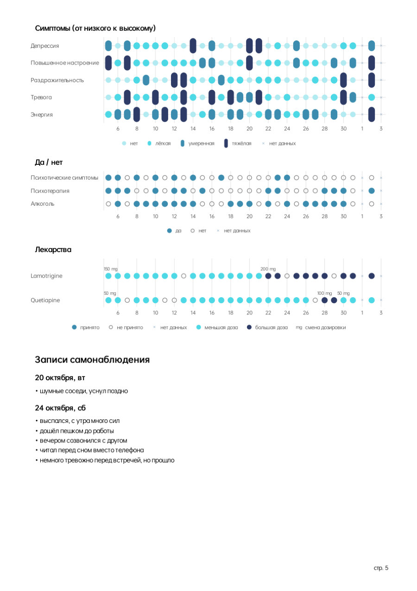

<p align="center">
  
</p>

<h1 align="center">Mindfuck</h1>

<p align="center">
  A private mood diary for Android in the spirit of eMoods: log sleep, mood, symptoms and medications in a few taps a day,<br>
  watch the charts, and hand your doctor a ready PDF report in Russian. Everything stays on the phone.
</p>

<p align="center">
  <a href="https://github.com/lemitz/Mindfuck/releases"></a>
  
  
  
  
</p>

<p align="center">
  <b>English</b> · <a href="README.ru.md">Русский</a>
</p>

---

Mindfuck is for people who track bipolar disorder, depression, anxiety and the like day by day, and who are tired of retelling a month of their life from memory at every appointment. Once a day you mark how you slept, how low, high, irritable and anxious you got, whether there were psychotic symptoms or therapy, what you took and at which dose, and jot down a few thoughts. The app turns that into eMoods-style charts and, when you need it, into a **"Дневник настроения и симптомов"** PDF in Russian that a psychiatrist can read in a minute.

The app's interface is in English; the report is always in Russian. There is no account, no cloud and no internet permission at all: the diary lives in a database on your phone, and the only way out is a file you export yourself.

<p align="center">
  
  
  
  
</p>
<p align="center">
  
  
  
</p>

## Features

**Log Moods**
- Last night's sleep in half-hour steps (slider plus − / + buttons)
- The day's most extreme **depressed mood, elevated mood, irritability and anxiety**: None / Mild / Moderate / Severe. Tap the selected option again to clear it
- **Psychotic symptoms** and **talk therapy**: yes / no
- **Custom tracking points** of your own: a None → Severe scale or yes / no (name them in Russian and they appear in the report as is)
- **Medications**: tick what you took. Each intake remembers the dose taken that day; change it for a single day from the chip next to the name, with quick picks of recent doses, and optionally make it the new default. Past days keep the dose they were logged with
- **Self-observation notes**: every line becomes a bullet in the report
- Saved instantly, no Save button. Jump to any day with the arrows or the date picker

**Calendar** - a month at a glance, each day coloured by its most severe symptom, a dot on days with notes.

**Graph** - 7, 30 or 90 days, scroll back in time:
- Sleep bars with the average as a dashed line
- Low-to-high tracking points drawn like eMoods: a dot for none, taller pills for mild, moderate and severe
- Yes / no points: filled = yes, faint ring = no, × = nothing logged
- Medications: taken / not taken, shaded by dose, with a label wherever the dose changed
- Every chart has a legend

**PDF report** - pick a period (last 7 / 14 / 30 days, this or the previous month, or any range) and the sections:
- **Base report, always included**, laid out like the paper diary it replaces: the 0-3 scale with white, light grey, grey and black cells, the day-by-day table with weekdays, a period summary that glues identical days together in proper Russian ("18–19 окт: умеренная. 20 окт: тяжёлая. 21 окт: не отмечалась."), and the self-observation notes of the last day with notes
- **Optional:** sleep (hours row, average, min and max), psychotic symptoms and therapy, medications (intake table, adherence in %, days per dose), custom tracking points, the same charts as in the app, notes for every day
- Long periods break into weekly blocks and flow over pages with repeated headers; page numbers at the bottom
- Files are named `mindfuck_DDMMYY.pdf`; a second report on the same day becomes `_v2`, then `_v3`, and so on. A copy goes to `Downloads/Mindfuck`; open or share it straight from the app

**Everything else**
- Swipe left and right between Log, Calendar, Graph and Report; settings slide in from the side; days, months and periods animate in the direction you move
- Dark theme by default, a light theme in Settings
- Asks the display for its fastest mode (120 Hz and up where the panel has it) and keeps drawing work light, so scrolling and swiping stay smooth
- Realme's *Real Choice* typeface everywhere, in the app and in the PDF
- Backup and restore of the whole diary as one JSON file
- **Import from eMoods:** pick the `export.emoods` file and your eMoods history is added to the diary. Nothing is deleted or overwritten: days you already logged keep their values and only get empty fields filled in, medications are matched by name, and a backup of the diary is saved to `Downloads/Mindfuck` before the import

> **Your data is health data.** Mindfuck never sends it anywhere, but the PDF reports and JSON backups you create are ordinary, unencrypted files. Share them only with people you mean to. See [SECURITY.md](SECURITY.md).

## Installation

Download from the [Releases](https://github.com/lemitz/Mindfuck/releases) page:

- `Mindfuck-<version>-android.apk` - open it on the phone and allow installing from your browser or file manager. Android 14 or newer.
- `SHA256SUMS.txt` - checksums. In PowerShell: `Get-FileHash .\Mindfuck-1.1.0-android.apk -Algorithm SHA256`.

Mindfuck does not update itself. An APK signed with a different key cannot be installed over the existing app, and uninstalling deletes the diary: **export a backup first** (Settings → Export all data).

## Development

Requirements: JDK 17+ (21 recommended) and the Android SDK with API 37. Point `local.properties` at the SDK (`sdk.dir=...`).

```bash
./gradlew :app:testDebugUnitTest     # Russian wording of the report, period gluing, file names
./gradlew :app:installDebug          # build and install on a connected device or emulator
```

The charts are drawn by one renderer on a plain `android.graphics.Canvas`, so the graphs on screen and in the PDF are the same code. The PDF itself is built with the platform `PdfDocument`; Russian dates, declensions and the period summary live in `RuText` and are covered by unit tests against the original paper report.

## Building

```powershell
./scripts/build.ps1              # tests and the release APK into dist/ with SHA256SUMS.txt
./scripts/build.ps1 -SkipTests   # faster
./scripts/build.ps1 -Offline     # Gradle without network (needs a warm cache)
```

The version is a single line in [`VERSION`](VERSION): it becomes the APK's `versionName` / `versionCode` and the release tag.

## Releasing

[`build.yml`](.github/workflows/build.yml) does everything:

- **Pull request to `main`:** unit tests and the release APK, attached to the run as an artifact so the change can be tried before merging. The run says whether merging will publish a release.
- **Merge to `main`:** the same build, then a **GitHub Release `v<VERSION>`** with `Mindfuck-<version>-android.apk` and `SHA256SUMS.txt`, with [`RELEASE_NOTES.md`](RELEASE_NOTES.md) plus the list of merged pull requests as its text. If that tag already exists nothing is published, so ordinary pull requests only build.
- **"Run workflow" button:** builds any branch, never publishes.

To ship a release, put these in the pull request: a new version in `VERSION` and a matching `RELEASE_NOTES.md` that starts with `# Mindfuck v<version>` (`./scripts/check-release.ps1` checks both, the workflow runs it too). Merge, and the release appears.

**Signing the APK.** Without secrets the release APK is signed with a throw-away debug key, which works but means every release has to be uninstalled (diary and all) before the next one is installed. Do it once properly:

```powershell
./scripts/make-keystore.ps1      # creates the key outside the repo and prints the four secrets
```

Add `ANDROID_KEYSTORE_BASE64`, `ANDROID_KEYSTORE_PASSWORD`, `ANDROID_KEY_ALIAS` and `ANDROID_KEY_PASSWORD` under *Settings → Secrets and variables → Actions* and keep a backup of the key: a lost key means users must uninstall to update.

## Project structure

```
VERSION                      the version of everything
assets/                      icon-circle.png (the README logo)
scripts/                     build.ps1, check-release.ps1, make-keystore.ps1
app/src/main/java/com/mindfuck/app/
  data/                      Room entities, DAO, migrations, repository, JSON backup
  charts/ChartRenderer.kt    eMoods-style charts on android.graphics.Canvas (screen and PDF)
  report/                    PDF builder, Russian wording (RuText), report options, file naming, export
  ui/                        Log, Calendar, Graph, Report, Settings; theme, fonts, shared controls
  MainActivity.kt            edge-to-edge, highest refresh rate, system bars per theme
app/src/main/res/            launcher icon (vector), Real Choice font
app/src/test/                unit tests for the report text and file names
docs/images/                 screenshots
.github/                     the build and release workflow, issue and pull request templates
```

## Tech stack

[Kotlin](https://kotlinlang.org) · [Jetpack Compose](https://developer.android.com/compose) with Material 3 · [Room](https://developer.android.com/training/data-storage/room) · Android `PdfDocument` and `Canvas` · [Gradle](https://gradle.org) · [GitHub Actions](https://github.com/features/actions)

## License

Mindfuck is released under the [MIT License](LICENSE). The bundled typeface and the icon glyph come with their own terms, see [THIRD-PARTY-NOTICES.md](THIRD-PARTY-NOTICES.md).

Mindfuck is not a medical device and does not give medical advice. It is a notebook; the conclusions are for you and your doctor.

---

<p align="center">
  <br>
  <sub>This project was built with the help of AI tools.</sub>
</p>
