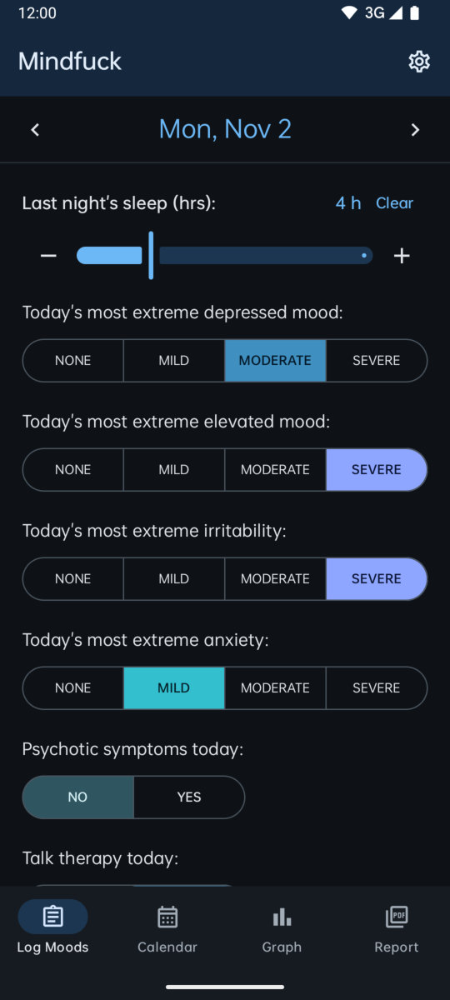
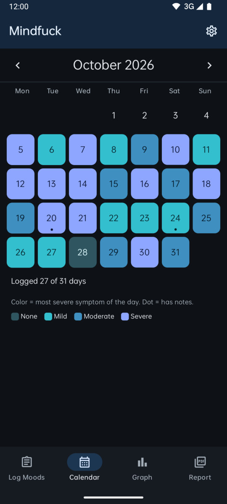
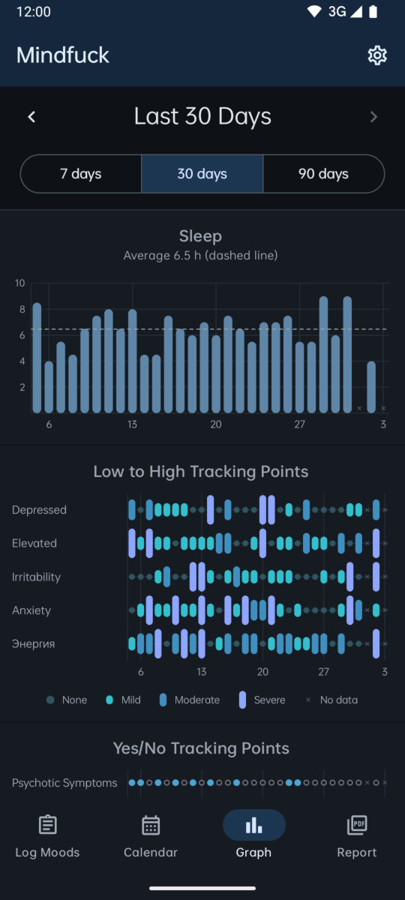
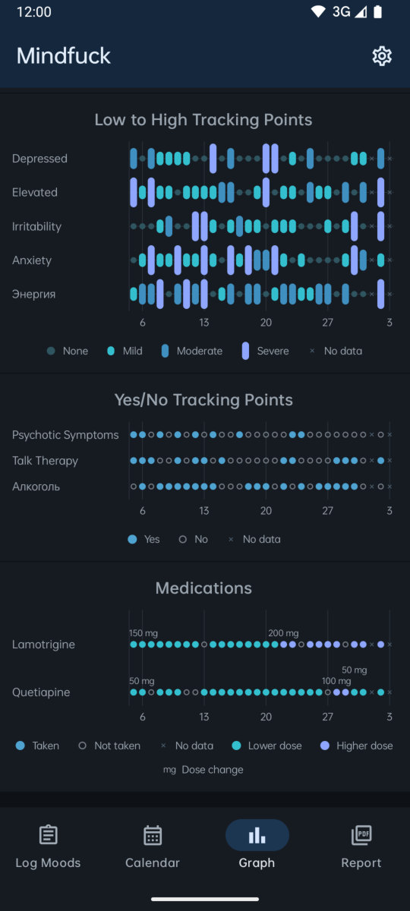
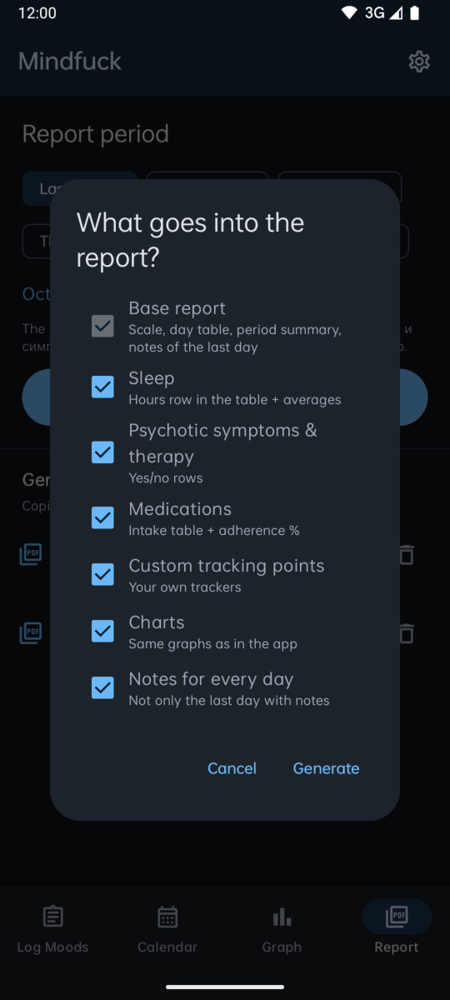
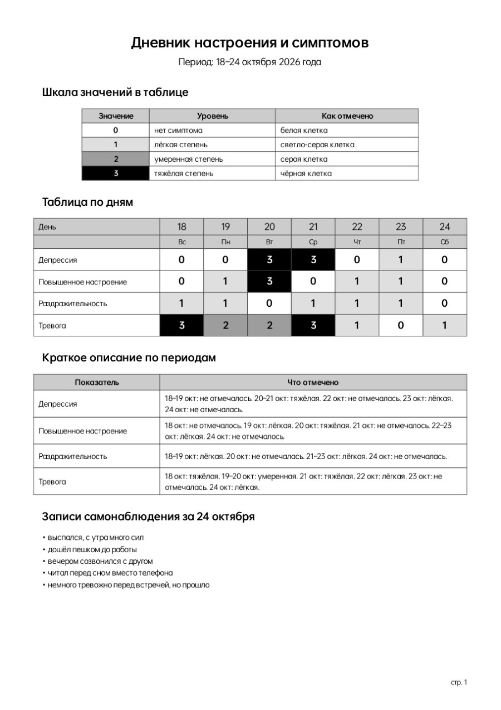
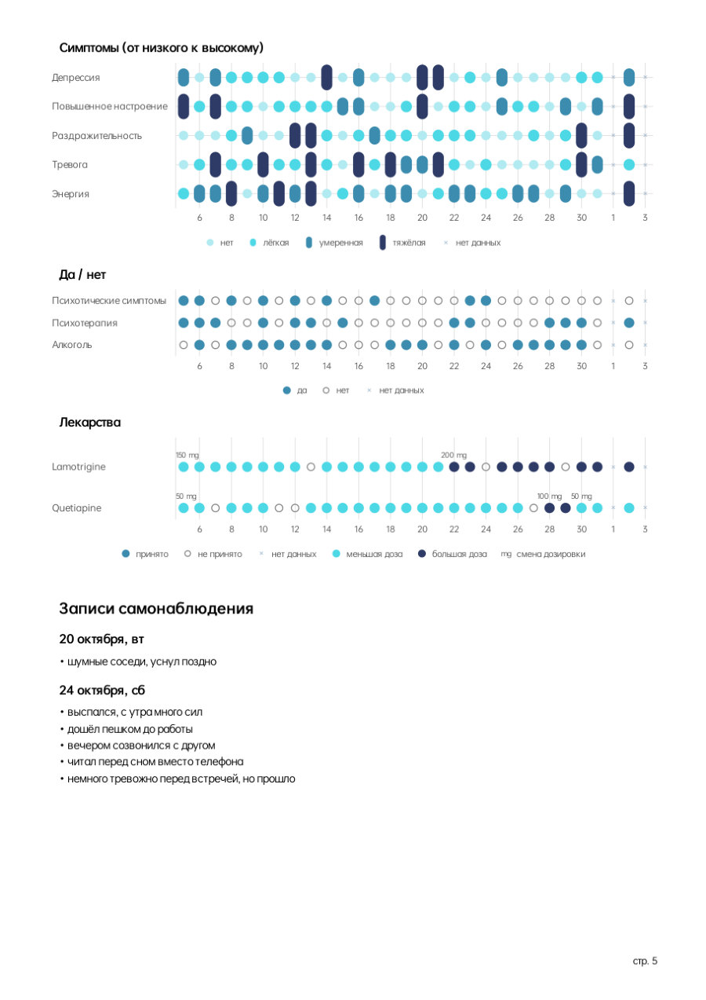

<p align="center">
  
</p>

<h1 align="center">Mindfuck</h1>

<p align="center">
  Личный дневник настроения для Android в духе eMoods: сон, настроение, симптомы и лекарства за пару касаний в день,<br>
  графики и готовый PDF-отчёт для врача на русском. Всё хранится только на телефоне.
</p>

<p align="center">
  <a href="https://github.com/lemitz/Mindfuck/releases"></a>
  
  
  
  
</p>

<p align="center">
  <a href="README.md">English</a> · <b>Русский</b>
</p>

---

Mindfuck для тех, кто отслеживает биполярное расстройство, депрессию, тревогу и прочее изо дня в день и устал на каждом приёме пересказывать месяц жизни по памяти. Раз в день отмечаешь, как спал, насколько было плохо, приподнято, раздражённо и тревожно, были ли психотические симптомы или психотерапия, что принял и в какой дозе, и записываешь пару мыслей. Приложение превращает это в графики как в eMoods, а когда нужно, в PDF «Дневник настроения и симптомов», который психиатр прочитает за минуту.

Интерфейс приложения на английском, отчёт всегда на русском. Нет ни аккаунта, ни облака, ни разрешения на интернет вообще: дневник лежит в базе на телефоне, и наружу он попадает только файлом, который ты выгрузил сам.

<p align="center">
  
  
  
  
</p>
<p align="center">
  
  
  
</p>

## Возможности

**Log Moods**
- Сон прошлой ночью с шагом полчаса (ползунок и кнопки − / +)
- Самые сильные за день **депрессия, повышенное настроение, раздражительность и тревога**: None / Mild / Moderate / Severe. Повторное нажатие на выбранный вариант снимает отметку
- **Психотические симптомы** и **психотерапия**: да / нет
- **Свои пункты**: шкала None → Severe или да / нет (назови их по-русски, и в отчёт они попадут как есть)
- **Лекарства**: отмечаешь, что принял. Каждый приём запоминает дозу за этот день; поменять её для одного дня можно кнопкой рядом с названием, с подсказками из недавних доз и галочкой «сделать дозой по умолчанию». Прошлые дни сохраняют ту дозу, с которой были записаны
- **Заметки самонаблюдения**: каждая строка становится пунктом в отчёте
- Сохраняется сразу, без кнопки «Сохранить». В любой день можно перейти стрелками или через календарь

**Calendar** - месяц целиком, каждый день окрашен по самому тяжёлому симптому, точка на днях с заметками.

**Graph** - 7, 30 или 90 дней с прокруткой назад:
- Столбики сна и среднее пунктиром
- Шкалы «от низкого к высокому», как в eMoods: точка для «нет», столбики разной высоты для лёгкой, умеренной и тяжёлой степени
- Да / нет: заполненный круг = да, тусклое кольцо = нет, × = ничего не отмечено
- Лекарства: принято / не принято, оттенок по дозе, подпись в каждой точке смены дозы
- У каждого графика есть легенда

**PDF-отчёт** - выбираешь период (последние 7 / 14 / 30 дней, текущий или прошлый месяц, любой диапазон) и разделы:
- **Базовый отчёт, всегда**, свёрстан как бумажный дневник, который он заменяет: шкала 0-3 с белыми, светло-серыми, серыми и чёрными клетками, таблица по дням с днями недели, краткое описание по периодам, где одинаковые дни склеены по-русски («18–19 окт: умеренная. 20 окт: тяжёлая. 21 окт: не отмечалась.»), и записи самонаблюдения за последний день с заметками
- **По желанию:** сон (строка часов, среднее, минимум и максимум), психотические симптомы и психотерапия, лекарства (таблица приёма, процент, дни по дозировкам), свои пункты, те же графики, что в приложении, заметки за все дни
- Длинные периоды разбиваются на недельные блоки и переносятся на следующие страницы с повтором шапки; внизу номера страниц
- Файлы называются `mindfuck_ДДММГГ.pdf`; второй отчёт за тот же день получает `_v2`, потом `_v3` и так далее. Копия кладётся в `Downloads/Mindfuck`, открыть или отправить можно прямо из приложения

**Остальное**
- Свайп влево и вправо между Log, Calendar, Graph и Report; настройки выезжают сбоку; дни, месяцы и периоды сдвигаются в сторону перехода
- Тёмная тема по умолчанию, светлая в настройках
- Запрашивает у экрана самый быстрый режим (120 Гц и выше, если панель умеет) и не нагружает отрисовку, поэтому прокрутка и свайпы плавные
- Шрифт Realme *Real Choice* везде: в приложении и в PDF
- Резервная копия и восстановление всего дневника одним JSON-файлом

> **Это медицинские данные.** Mindfuck никуда их не отправляет, но PDF-отчёты и JSON-бэкапы, которые ты создаёшь, это обычные незашифрованные файлы. Отдавай их только тем, кому собирался. См. [SECURITY.md](SECURITY.md).

## Установка

Скачай со страницы [Releases](https://github.com/lemitz/Mindfuck/releases):

- `Mindfuck-<версия>-android.apk` - открой на телефоне и разреши установку из браузера или файлового менеджера. Android 14 или новее.
- `SHA256SUMS.txt` - контрольные суммы. В PowerShell: `Get-FileHash .\Mindfuck-1.0.0-android.apk -Algorithm SHA256`.

Mindfuck не обновляется сам. APK, подписанный другим ключом, не встанет поверх установленного, а удаление приложения стирает дневник: **сначала сделай бэкап** (Settings → Export all data).

## Разработка

Нужны JDK 17+ (лучше 21) и Android SDK с API 37. Путь к SDK укажи в `local.properties` (`sdk.dir=...`).

```bash
./gradlew :app:testDebugUnitTest     # русские формулировки отчёта, склейка периодов, имена файлов
./gradlew :app:installDebug          # собрать и поставить на подключённое устройство или эмулятор
```

Графики рисует один рендерер на обычном `android.graphics.Canvas`, поэтому на экране и в PDF это один и тот же код. PDF собирается платформенным `PdfDocument`; русские даты, склонения и описание по периодам живут в `RuText` и покрыты тестами по исходному бумажному отчёту.

## Сборка

```powershell
./scripts/build.ps1              # тесты и release APK в dist/ вместе с SHA256SUMS.txt
./scripts/build.ps1 -SkipTests   # быстрее
./scripts/build.ps1 -Offline     # Gradle без сети (нужен прогретый кэш)
```

Версия - одна строка в [`VERSION`](VERSION): из неё берутся `versionName` / `versionCode` APK и тег релиза.

## Релизы

Всё делает [`build.yml`](.github/workflows/build.yml):

- **Pull request в `main`:** тесты и release APK, который прикрепляется к прогону как артефакт, чтобы изменение можно было попробовать до слияния. Прогон сообщает, опубликует ли слияние релиз.
- **Слияние в `main`:** та же сборка, затем **GitHub Release `v<VERSION>`** с `Mindfuck-<версия>-android.apk` и `SHA256SUMS.txt`; текст - [`RELEASE_NOTES.md`](RELEASE_NOTES.md) плюс список слитых pull request. Если такой тег уже есть, ничего не публикуется, так что обычные pull request только собираются.
- **Кнопка «Run workflow»:** собирает любую ветку, никогда не публикует.

Чтобы выпустить релиз, положи в pull request новую версию в `VERSION` и `RELEASE_NOTES.md`, который начинается с `# Mindfuck v<версия>` (`./scripts/check-release.ps1` проверяет оба, workflow тоже его запускает). Слей, и релиз появится.

**Подпись APK.** Без секретов release APK подписывается одноразовым отладочным ключом: он ставится, но перед каждой новой версией приложение придётся удалять вместе с дневником. Сделай один раз нормально:

```powershell
./scripts/make-keystore.ps1      # создаёт ключ вне репозитория и печатает четыре секрета
```

Добавь `ANDROID_KEYSTORE_BASE64`, `ANDROID_KEYSTORE_PASSWORD`, `ANDROID_KEY_ALIAS` и `ANDROID_KEY_PASSWORD` в *Settings → Secrets and variables → Actions* и сохрани копию ключа: потерянный ключ значит, что для обновления придётся удалять приложение.

## Структура проекта

```
VERSION                      версия всего
assets/                      icon-circle.png (логотип для README)
scripts/                     build.ps1, check-release.ps1, make-keystore.ps1
app/src/main/java/com/mindfuck/app/
  data/                      сущности Room, DAO, миграции, репозиторий, JSON-бэкап
  charts/ChartRenderer.kt    графики в стиле eMoods на android.graphics.Canvas (экран и PDF)
  report/                    сборка PDF, русские формулировки (RuText), опции отчёта, имена файлов, экспорт
  ui/                        Log, Calendar, Graph, Report, Settings; тема, шрифты, общие элементы
  MainActivity.kt            edge-to-edge, максимальная частота экрана, системные панели по теме
app/src/main/res/            векторная иконка, шрифт Real Choice
app/src/test/                тесты текста отчёта и имён файлов
docs/images/                 скриншоты
.github/                     workflow сборки и релизов, шаблоны issue и pull request
```

## Стек

[Kotlin](https://kotlinlang.org) · [Jetpack Compose](https://developer.android.com/compose) и Material 3 · [Room](https://developer.android.com/training/data-storage/room) · Android `PdfDocument` и `Canvas` · [Gradle](https://gradle.org) · [GitHub Actions](https://github.com/features/actions)

## Лицензия

Mindfuck распространяется по [лицензии MIT](LICENSE). У встроенного шрифта и значка мозга свои условия, см. [THIRD-PARTY-NOTICES.md](THIRD-PARTY-NOTICES.md).

Mindfuck не медицинское изделие и не даёт медицинских советов. Это блокнот; выводы делаете вы с врачом.

---

<p align="center">
  <br>
  <sub>Проект создан с помощью инструментов ИИ.</sub>
</p>
